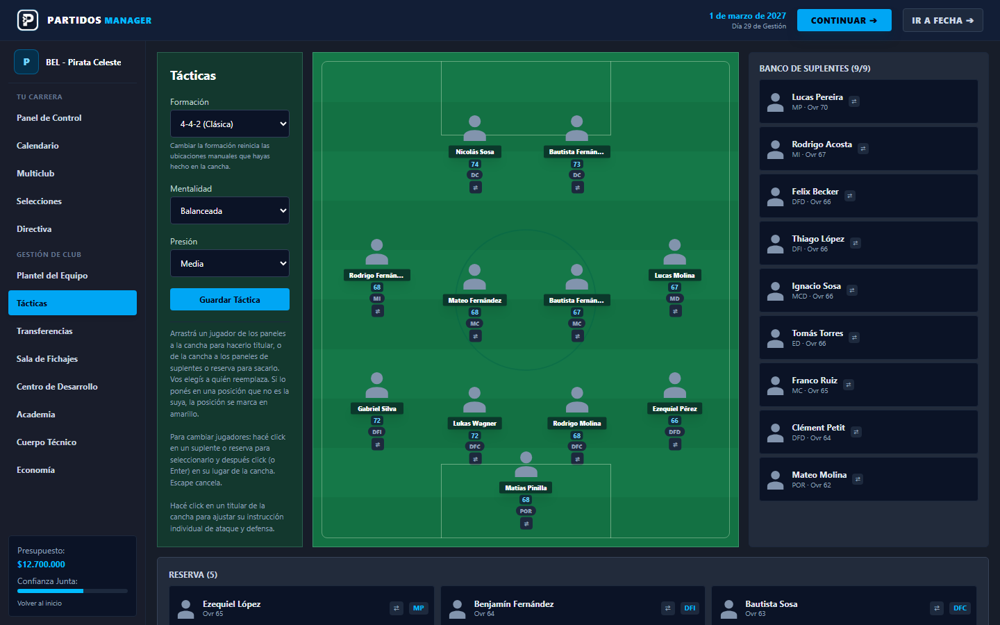
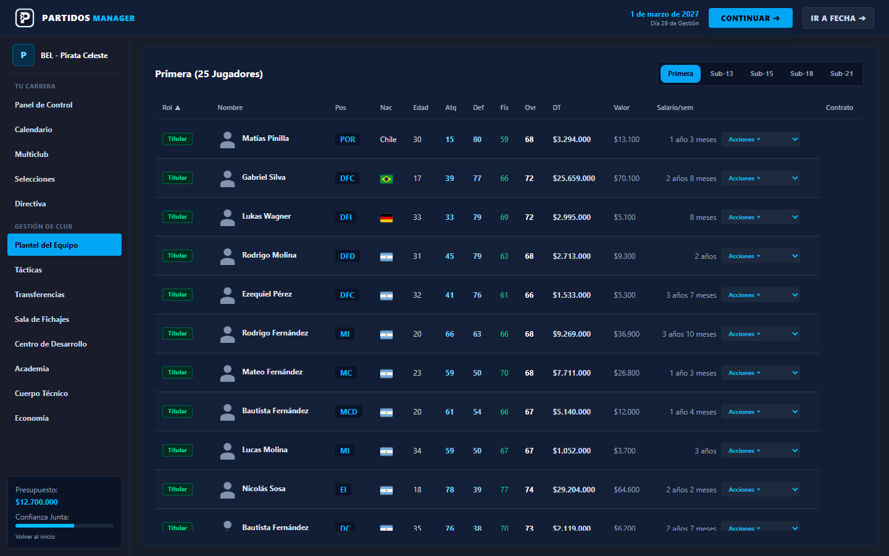
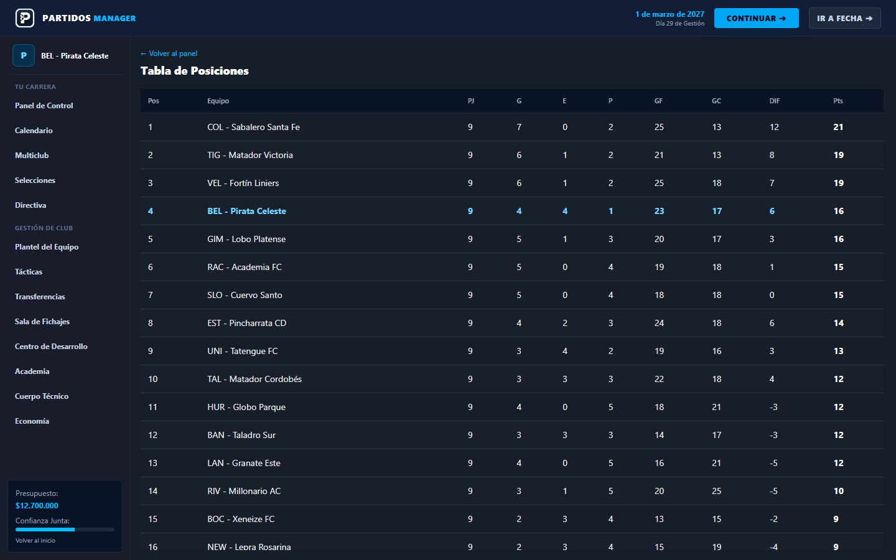
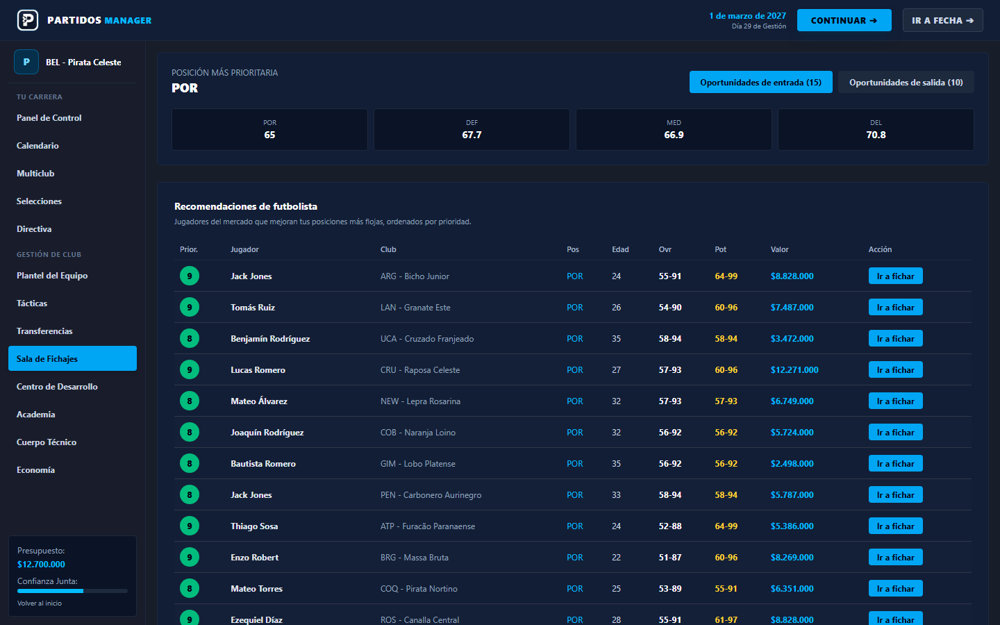
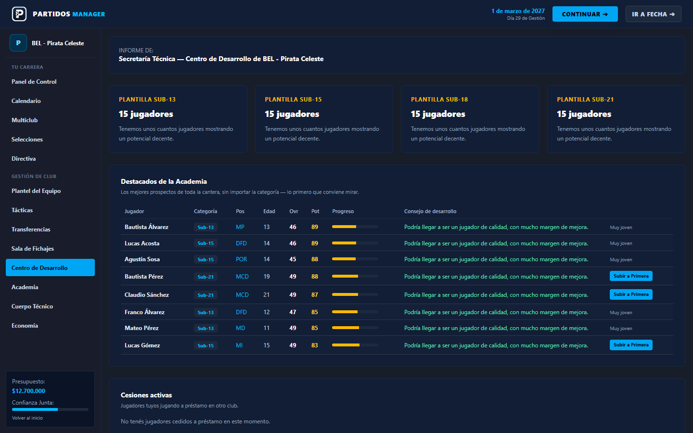

# Partidos Soccer Manager



| Squad · Plantel | Standings · Tabla |
|---|---|
|  |  |
| **Transfer room · Sala de fichajes** | **Development center · Centro de desarrollo** |
|  |  |

<sub>Screenshots use the fictional data pack · Las capturas usan la base ficticia</sub>

[English](#english) · [Español](#español)

---

## English

A football management simulation for the web, in the style of Football Manager: run a club through seasons, with squad management, tactics, transfers, contracts, training, youth academy and a minute-by-minute match engine.

### Features

- **Match engine:** minute-by-minute simulation with tactical modifiers (formation, mentality) and AI teams that adjust their approach to the scoreline
- **Transfer market:** offers, negotiations, loans and transfer windows; AI clubs sign players for their weakest positions and bid for yours
- **Contracts and economy:** wages, contract negotiation, club finances and board expectations
- **Squad development:** weekly training, individual development, injuries, ageing and retirements
- **Competitions:** leagues, cups, tournaments and national teams
- **Multi-club careers:** start a career, manage several clubs, talk to players and staff
- **3D pitch view** built with Three.js
- **Data packs:** load league and player data from external packs, with validated formats and ratings

The default data pack is fully fictional: player names, clubs and attributes are created by the game's own generator, never copied from licensed databases. Other data packs can be loaded and edited with the in-game editor.

### Tech

| Layer | Stack |
|---|---|
| Frontend | React 19, Vite, React Router, Tailwind CSS 4, Three.js |
| Backend | Python, FastAPI, SQLAlchemy (async), Pydantic |
| Database | PostgreSQL (Neon) or SQLite for local development |
| Tests | pytest |

### Architecture

```
api/routers/      20 FastAPI routers, one per domain (transfers, tactics, simulation, contracts, academy...)
engine/           13 simulation engines (match, tactics, transfers, contracts, training, injuries, season, AI...)
models.py         SQLAlchemy ORM models
schemas.py        Pydantic request/response schemas
pack_*.py         data pack loading, formats, ratings, contracts and market values
seed.py           generates a fictional league to start playing
tests/            pytest suite for the API and data packs
soccer-frontend/  React app: 22 pages and 20+ reusable components
```

The game logic lives in the `engine/` modules and is independent of the API layer, so each system (match, transfers, training...) can be tested and changed on its own.

### Run locally

**Backend**

```bash
python -m venv .venv
.venv\Scripts\activate          # Windows
# source .venv/bin/activate     # Mac/Linux
pip install -r requirements.txt

cp .env.example .env            # set DATABASE_URL (or use SQLite: sqlite+aiosqlite:///./soccer.db)
python seed.py                  # create a fictional league
uvicorn main:app --reload       # API docs at http://127.0.0.1:8000/docs
```

**Frontend**

```bash
cd soccer-frontend
npm install
npm run dev
```

**Tests**

```bash
pytest
```

Detailed development notes (in Spanish) are in [docs/DEVELOPMENT.md](docs/DEVELOPMENT.md).

---

## Español

Simulador de gestión de fútbol para la web, al estilo de Football Manager: dirigís un club a lo largo de varias temporadas, con gestión del plantel, tácticas, fichajes, contratos, entrenamiento, cantera y un motor de partidos minuto a minuto.

### Funcionalidades

- **Motor de partidos:** simulación minuto a minuto con modificadores tácticos (formación, mentalidad) y equipos de la IA que ajustan su planteo según el marcador
- **Mercado de pases:** ofertas, negociaciones, préstamos y ventanas de transferencias; los clubes de la IA fichan para sus posiciones más flojas y hacen ofertas por tus jugadores
- **Contratos y economía:** salarios, negociación de contratos, finanzas del club y expectativas de la directiva
- **Desarrollo del plantel:** entrenamiento semanal, desarrollo individual, lesiones, envejecimiento y retiros
- **Competiciones:** ligas, copas, torneos y selecciones nacionales
- **Carreras multiclub:** empezás una carrera, dirigís varios clubes y hablás con jugadores y cuerpo técnico
- **Vista 3D de la cancha** hecha con Three.js
- **Data packs:** carga de datos de ligas y jugadores desde packs externos, con formatos y valoraciones validados

La base de datos por defecto es completamente ficticia: los nombres de jugadores, los clubes y los atributos los crea el generador del propio juego, nunca se copian de bases de datos con licencia. Se pueden cargar otros data packs y editarlos con el editor del juego.

### Tecnologías

| Capa | Stack |
|---|---|
| Frontend | React 19, Vite, React Router, Tailwind CSS 4, Three.js |
| Backend | Python, FastAPI, SQLAlchemy (async), Pydantic |
| Base de datos | PostgreSQL (Neon) o SQLite para desarrollo local |
| Tests | pytest |

### Arquitectura

```
api/routers/      20 routers de FastAPI, uno por dominio (fichajes, tácticas, simulación, contratos, cantera...)
engine/           13 motores de simulación (partido, tácticas, fichajes, contratos, entrenamiento, lesiones, temporada, IA...)
models.py         modelos ORM de SQLAlchemy
schemas.py        esquemas Pydantic de requests y respuestas
pack_*.py         carga de data packs, formatos, valoraciones, contratos y valores de mercado
seed.py           genera una liga ficticia para empezar a jugar
tests/            tests con pytest para la API y los data packs
soccer-frontend/  app en React: 22 páginas y más de 20 componentes reutilizables
```

La lógica del juego vive en los módulos de `engine/` y es independiente de la capa de la API, así que cada sistema (partido, fichajes, entrenamiento...) se puede probar y modificar por separado.

### Cómo correrlo

**Backend**

```bash
python -m venv .venv
.venv\Scripts\activate          # Windows
# source .venv/bin/activate     # Mac/Linux
pip install -r requirements.txt

cp .env.example .env            # definí DATABASE_URL (o usá SQLite: sqlite+aiosqlite:///./soccer.db)
python seed.py                  # crea una liga ficticia
uvicorn main:app --reload       # documentación de la API en http://127.0.0.1:8000/docs
```

**Frontend**

```bash
cd soccer-frontend
npm install
npm run dev
```

**Tests**

```bash
pytest
```

Las notas de desarrollo detalladas están en [docs/DEVELOPMENT.md](docs/DEVELOPMENT.md).
